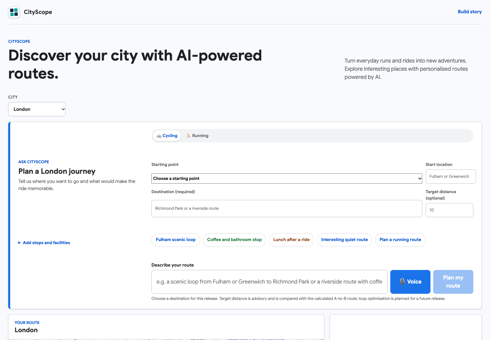
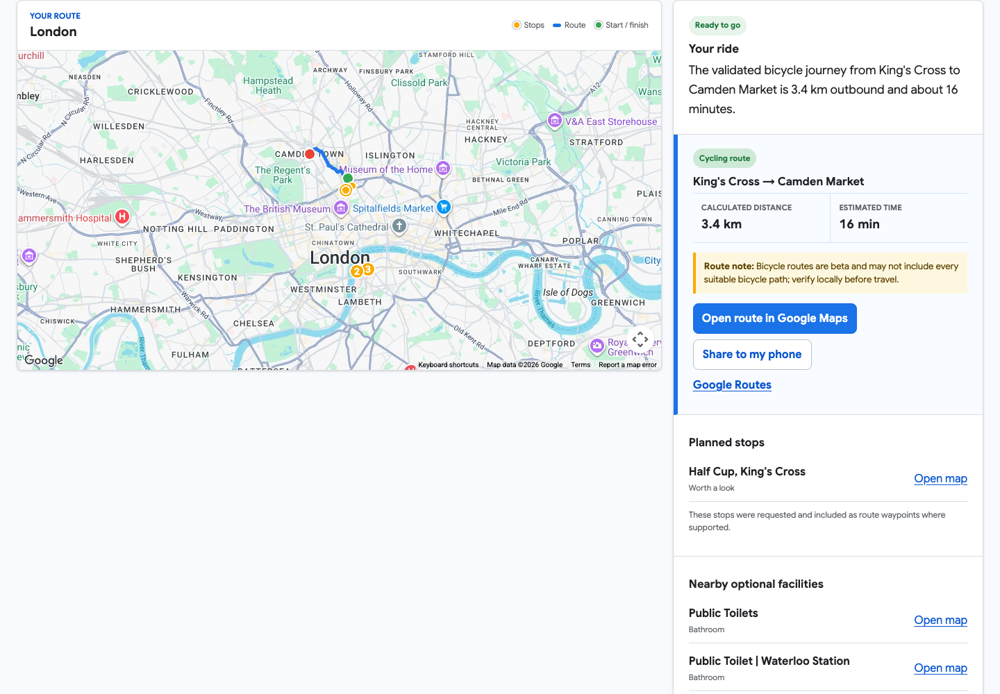
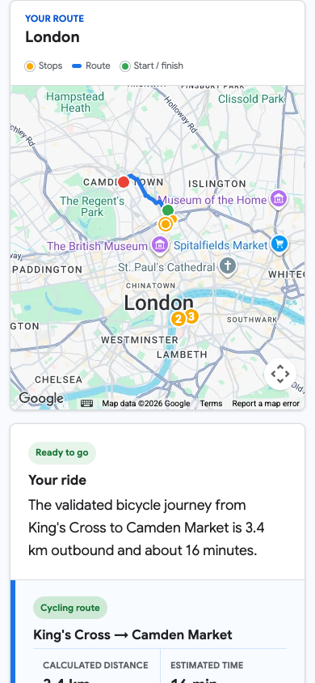
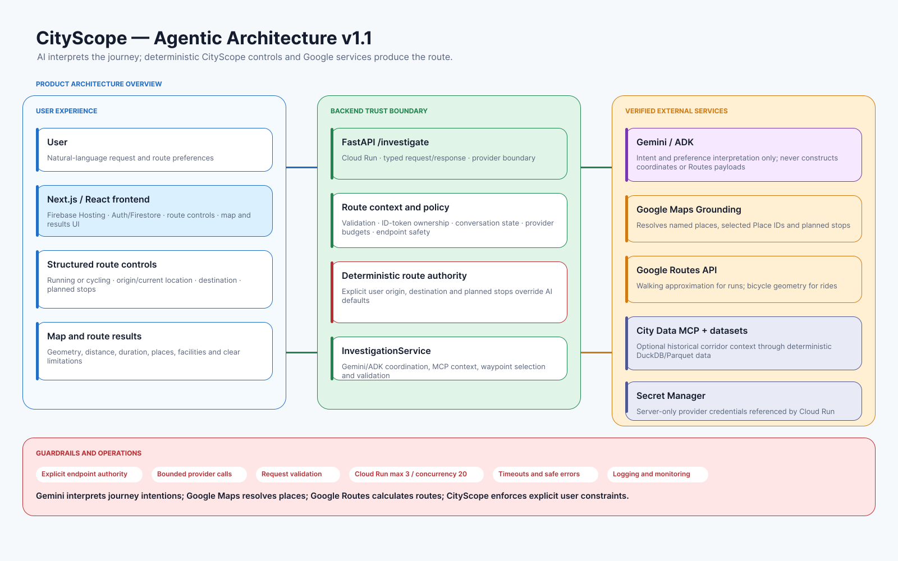

# CityScope

**Discover your city with AI-powered routes.**

[](https://github.com/Peippo1/CityScope/actions/workflows/ci.yml)


CityScope turns a natural-language request and structured route controls into a grounded running or cycling journey. Choose an origin and destination, add an optional café or restaurant waypoint, discover nearby facilities, and refine the plan without giving the model authority over your endpoints.

**[Try CityScope](https://cityscope-506222.web.app/)** · [Read the build story](https://tfinch.dev/writing/building-cityscope) · [Explore the architecture](docs/architecture/route-navigation.md)

## Product



CityScope is designed around a clear A-to-B journey:

- choose running or cycling;
- start from a named place, selected Google place, or browser location;
- provide an explicit destination;
- add up to two planned stops that may change the route;
- discover nearby cafés, restaurants, toilets, or useful shops without automatic detours;
- compare an advisory target distance with the route's calculated distance; and
- refine the request while preserving the original route context.
- switch the planner between English, French, Spanish, and Italian; browser language is detected by default and a manual choice is remembered.



<p align="center">
  
</p>

The screenshot above is a production King’s Cross → Camden Market cycling route with a requested café waypoint. Planned stops are part of the journey; nearby facilities are suggestions and do not change its geometry.

## Architecture



The FastAPI service is the trust boundary. Gemini interprets intent and preferences; Google Maps Grounding resolves places; Google Routes calculates walking or bicycle geometry; deterministic CityScope code owns endpoint authority, provider budgets, waypoint validation, and the public response.

Route-only coverage currently includes London, Paris, Madrid, Rome, Copenhagen, Barcelona, New York City, Chicago, and Washington, DC. Historical mobility enrichment remains limited to the cities with an available CityScope dataset; live Google Maps and Routes coverage is used independently where supported.

[Open the editable architecture in Figma](https://www.figma.com/design/oCm6LzC2ZAACrkFTm4PllS) · [View the detailed request flow](docs/assets/architecture/cityscope-agentic-request-flow.svg) · [Read the route-navigation notes](docs/architecture/route-navigation.md)

## Technology

| Layer | Technology |
| --- | --- |
| Web | Next.js 15, React 18, TypeScript, Google Maps JavaScript API |
| API | FastAPI, Pydantic, Google ADK, Google GenAI SDK |
| Routing and places | Google Routes API, Google Maps Grounding MCP |
| Data | H3, DuckDB, Parquet, deterministic City Data MCP |
| Identity and saved routes | Firebase Authentication, server-owned Firestore access |
| Production | Firebase Hosting, Cloud Run, Secret Manager, Artifact Registry |

## Agentic controls

CityScope treats model output and retrieved place content as untrusted:

1. The browser sends a typed request with structured route context.
2. Gemini can interpret intent and preferences, but cannot supply coordinates, Place IDs, provider payloads, or arbitrary tool names.
3. Explicit origins, destinations, and planned stops remain authoritative.
4. Selected locations use either a validated Place ID or a coordinate pair; conflicting representations are rejected.
5. Generic inferred stops must stay within the route corridor and detour budget. Explicit named stops are retained, with a warning when they create a substantial detour.
6. The backend allowlists tools, validates arguments, limits calls, and checks the final route before returning it.

See [route-navigation architecture](docs/architecture/route-navigation.md) for the complete request lifecycle and trust boundaries.

## Security and operations

- Server credentials stay in Secret Manager or server-side environment variables; no server key is exposed through `NEXT_PUBLIC_*` configuration.
- Public requests are schema validated, limited to 16 KB, and bounded by per-instance rate, concurrency, and timeout controls.
- Each investigation permits at most three model rounds, three City Data calls, ten Maps searches, two Routes calls, and two route waypoints.
- Production Cloud Run is capped at three instances with container concurrency 20. The application separately caps active investigations at eight per instance.
- Firebase ID tokens are verified by the API; browser Firestore access is denied and saved-route ownership is checked server-side.
- Provider links are restricted to approved HTTPS Google domains.
- Structured logs contain correlation IDs, status, duration, provider/tool outcomes, and budget metadata—not raw prompts, coordinates, credentials, tokens, or provider payloads.
- Provider failures and spending-limit exhaustion return bounded, sanitised errors rather than internal details.

Operational details live in the [deployment runbook](docs/deployment.md) and [privacy notice](docs/privacy.md).

## Local development

Prerequisites: Python 3.11+, Node.js 20+, and npm.

```bash
python3 -m venv .venv
source .venv/bin/activate
python -m pip install -e '.[dev]'
python -m pipelines.london_cycling.build_fixture
python -m pipelines.multicity.build_fixture

cd apps/web
npm ci
cd ../..

cp .env.example .env.local
python scripts/dev.py
```

Add only the provider credentials you intend to use to `.env.local`. Browser-only configuration belongs in `apps/web/.env.local`; never put a server credential in a `NEXT_PUBLIC_*` variable. The supervisor prints the local web URL and stops the stack if a required process exits.

API health is available at `http://localhost:8000/health`; dataset readiness is at `http://localhost:8000/ready`.

## Testing

```bash
pytest -q
python -m evals.agent.runner --json-output /tmp/cityscope-eval-report.json

cd apps/web
npm test
npm run lint
npm run test:e2e
npm run build
```

CI also runs Python and npm dependency audits. Live Gemini, Maps, and Routes checks are opt-in so routine test runs do not consume provider quota.

## Known limitations

- A destination is required. Approximate-distance loop generation is not implemented; target distance is advisory for an A-to-B route.
- Running uses Google walking geometry. Users should verify surfaces, crossings, access, and local conditions before travelling.
- Facility categories describe provider results; CityScope does not guarantee public access, opening hours, or current availability.
- Historical bike-share evidence is a matched May 2026 snapshot, not live activity and not a census of all cycling.
- The map uses legacy Google Maps markers until a compatible Map ID can be reviewed; the current API remains supported but emits a deprecation warning.

## Roadmap

- bounded approximate-distance loop planning;
- stronger facility relevance and availability signals where provider data supports them;
- Advanced Markers after Map ID and billing review; and
- additional validated city datasets and route templates.

## More documentation

- [Investigation model and guardrails](docs/investigations.md)
- [Data foundation and provenance](docs/data-foundation.md)
- [Privacy and saved-route handling](docs/privacy.md)
- [Architecture decisions](docs/decisions)
- [All Things Agentic Hackathon submission](docs/devpost-submission.md)
