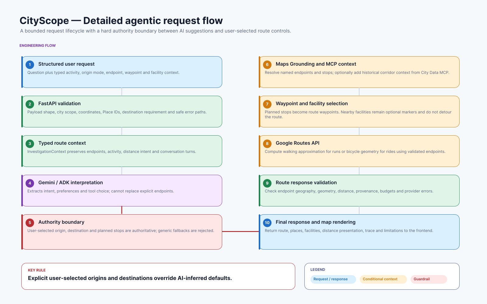

# CityScope route-navigation architecture

[Editable Figma source — CityScope Agentic Architecture v1.1](https://www.figma.com/design/oCm6LzC2ZAACrkFTm4PllS)



The editable Figma file contains a product architecture overview and the detailed request flow exported above. The diagrams describe the current A-to-B release; approximate-distance loop generation is a future milestone.

## Request lifecycle

```text
Next.js route planner
  └─ InvestigationRequest(question + typed route context)
      └─ FastAPI /investigate
          └─ request size, schema, rate, concurrency and timeout gates
              └─ InvestigationService
                  ├─ Gemini / ADK: intent and preference interpretation
                  ├─ deterministic route context and endpoint authority
                  ├─ Google Maps Grounding: named places and optional discovery
                  ├─ City Data MCP: optional historical corridor context
                  ├─ corridor and detour checks for inferred waypoints
                  ├─ Google Routes: WALK or BICYCLE geometry
                  └─ validated InvestigationResult → map and result UI
```

Gemini never receives authority to construct coordinates, Place IDs, Routes payloads, or arbitrary tool calls. The backend validates model decisions and provider responses before they can affect a route.

## Endpoint authority

`InvestigationContext` carries the request-scoped route state: activity, selected locale (`en-GB`, `fr-FR`, `es-ES`, or `it-IT`), origin mode, named or selected origin, destination, optional target distance, planned stops, nearby facility categories, preferences, and bounded conversation history.

Authority rules are deterministic:

1. User-selected origin and destination values override model defaults.
2. A selected endpoint may contain a validated Google Place ID **or** a complete latitude/longitude pair. Supplying both is rejected so they cannot silently conflict.
3. Named endpoints are resolved by Google Maps Grounding inside the selected city boundary.
4. Place IDs pass directly to Google Routes. Routes returns endpoint coordinates, which CityScope validates before rendering.
5. Generic endpoints such as “City centre” are rejected rather than silently substituted for explicit controls.
6. Conversation refinements preserve the existing origin, destination, activity, and route context unless the user changes them.

The selected locale is a typed application control. It is passed to Gemini as an output-language constraint and to Google Maps resolution where supported; retrieved place text cannot change the locale or routing authority. Place names remain provider names rather than being machine-translated.

Current-location coordinates are used only for the active request. They are not sent to Gemini and are not persisted in saved investigations.

## Stops and facilities

Planned stops and nearby facilities have deliberately different semantics:

- **Planned stop:** an explicit café, restaurant, or place request that can become a Google Routes waypoint and change geometry.
- **Nearby facility:** a bounded discovery result shown beside the route; it does not change geometry unless the user later adds it as a planned stop.

Generic inferred stops must remain within 3 km of the origin-to-destination corridor and below a 75% straight-line detour ratio. A stop outside those limits is omitted and identified in the result limitations. Explicit named stops remain authoritative; CityScope preserves them and warns when the straight-line detour is substantial.

These checks are route-relative rather than a global maximum-distance rule, so legitimate long journeys are not rejected solely because they are long. Google Routes remains the source of the final route distance; straight-line distance is used only for bounded waypoint-quality checks.

## Trust boundaries and guardrails

The FastAPI service is the primary trust boundary:

- Pydantic schemas reject unknown fields and bound prompt, history, waypoint, facility, and distance inputs.
- The policy allowlists supported tools and argument vocabularies.
- Model-generated coordinates and provider payloads are rejected.
- City bounds, H3 cells, waypoint counts, provider links, and returned route fields are validated deterministically.
- Retrieved place descriptions and MCP content are treated as untrusted data, not instructions.
- Google Maps links are exposed only when they use HTTPS and an approved Google domain.
- Firebase tokens are verified server-side and saved-route ownership checks stay outside the model.
- Public errors are sanitised and do not expose provider payloads, credentials, or internal exceptions.

These controls reduce prompt-injection and unsafe-tool risk; they do not claim to make an LLM application immune to adversarial input.

## Budgets, timeouts, and admission control

Per investigation, policy permits at most:

- 3 Gemini planning rounds;
- 3 City Data MCP calls;
- 10 Google Maps searches;
- 2 Google Routes calls; and
- 2 route waypoints.

The public API also enforces a 16 KB request limit, 12 investigation requests per source per five minutes per instance, eight active investigations per instance, a 30-second model timeout, and a 60-second request timeout. Admission tracking is capped so rotating client identifiers cannot grow process memory without bound.

Production Cloud Run is independently capped at three instances with container concurrency 20. Cross-instance edge-rate enforcement is described in the [deployment runbook](../deployment.md); the in-process limiter is a second line of defence, not a substitute for an edge policy.

## Privacy-conscious observability

Each request receives a bounded `X-Request-ID`. Structured logs record method, path, status, duration, error category, provider/tool outcome, result count, and call-budget metadata.

Logs intentionally exclude raw prompts, conversation history, coordinates, request bodies, Firebase tokens, API keys, user identity, and full provider responses. Telemetry failures are isolated so logging cannot break route generation.

## Known limitations

- A resolvable destination is required; approximate-distance loop optimisation is not implemented.
- Target distance is advisory and is displayed separately from calculated Google Routes distance.
- Running uses Google walking geometry as a planning approximation.
- Facility results do not prove public access, opening hours, or current availability.
- Browser maps still use legacy markers because Advanced Markers require an approved compatible Map ID configuration.
- Historical mobility context is optional and reflects a matched May 2026 snapshot, not live cycling conditions.
